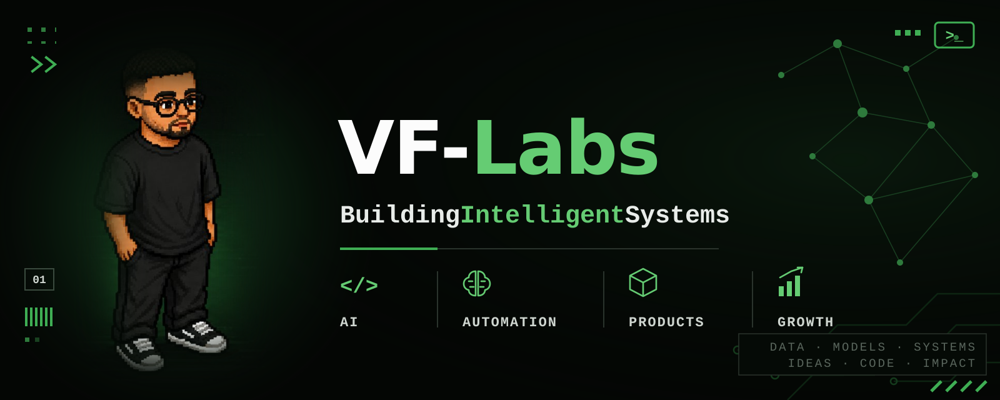

<div align="center">
  


<br>


<br><br>

<a href="https://github.com/Victorfiallho?tab=followers">
  
</a>

<a href="https://github.com/Victorfiallho?tab=repositories">
  
</a>

</div>

---

## `01`  `>_ whoami`

```python
class VictorFialho:
    location = "Anápolis, Brazil 🇧🇷"
    roles = [
        "AI Engineering @ UniEVANGÉLICA",
        "Founder @ AoTomate Sistemas",
        "Automation Analyst @ DataCrazy CRM",
    ]
    languages = {"PT": "native", "EN": "fluent", "ES": "advanced"}
    off_duty  = ["Jiu-Jitsu", "philosophy of mind", "history of mathematics"]
```

I build AI agents, automation pipelines, and full-stack systems for real operations. My work spans architecture, implementation, deployment, monitoring, and production debugging — from multi-tenant WhatsApp agents to retrieval systems with evaluation suites.

---

## `02`  `>_ Featured projects`

<table>
<tr>
<td width="50%" valign="top">

### 🎓 SIMPA
**Academic Monitoring & Risk Prediction Platform**

 

Records grades and attendance, computes statistical indicators, and classifies each student's academic risk with an explanation of why — all exposed through a secure REST API.

- Services `auth`, `academico` and `analitico`, each with its own DB, behind an nginx gateway
- Event-driven risk recalculation via RabbitMQ worker
- JWT RS256, regression-based prediction, PDF/Excel reports
- Requirements traceability (SRS, ERD, decision log)


**[→ Source](https://github.com/Victorfiallho/simpa)**

</td>
<td width="50%" valign="top">

### 🍽️ Racha
**Split the Restaurant Bill at the Table**

 

Customers tap an NFC tag or scan a QR code on the table, mark what they ordered (or split evenly), and pay their share via Pix. The table closes itself once everything is paid.

- Ingestion layer normalizing bills from API, POS connectors, print capture or manual panel
- Requirements, use cases, domain model with state machines, and ADRs
- Contracts up front: OpenAPI + JSON Schema
- 3D-printed table piece combining QR code and NFC


**[→ Source](https://github.com/Victorfiallho/Racha)**

</td>
</tr>
<tr>
<td width="50%" valign="top">

### 🔎 RAG Agent
**Retrieval-Augmented Q&A with Evaluation**

 

A document Q&A pipeline covering ingestion, embeddings, retrieval, grounded generation, and systematic evaluation of retrieval quality and answer faithfulness.

- End-to-end ingestion and semantic retrieval
- Grounded responses backed by retrieved context
- Repeatable retrieval & faithfulness metrics


🔒 *Private during active development · write-up on request*

</td>
<td width="50%" valign="top">

### 💰 Orçador
**Pricing & Scope Engine**

 

Turns a client brief into structured pricing and scope output using service-tier rules and LLM-generated JSON — and my learning-by-building vehicle for every layer of a full-stack product.

- Unstructured requirements → predictable JSON
- Consistent proposals from service-tier and pricing rules
- HTTP, data modeling, backend, frontend and deployment


🔒 *Private during active development · write-up on request*

</td>
</tr>
</table>

<div align="center">

**Also on GitHub:** [LeetCode Solutions](https://github.com/Victorfiallho/LeetCode-Solutions) — Python & SQL, organized by topic · [Portfolio](https://github.com/Victorfiallho/victorfiallho.github.io) — projects & interactive demos

<a href="https://github.com/Victorfiallho?tab=repositories">
  
</a>

</div>

---

## `03`  `>_ Current focus`

```bash
victor@vf-labs:~$ ./roadmap --active

[NOW ]  RAG systems       embeddings · retrieval · evaluation · faithfulness
[NOW ]  Agentic AI        orchestration · tool use · reliable workflows
[NOW ]  Full-stack        JavaScript · SQL · React/Next.js · deployment
[NOW ]  AI Engineering    calculus · linear algebra · computer science
[NOW ]  Security          offensive security · Linux · web app pentesting
[NEXT]  Cloud             AWS AI Practitioner certification track
[NEXT]  Pentest           SYCP — Solyd Certified Pentester

victor@vf-labs:~$
```

---

## `04`  `>_ Certifications & security`

<div align="center">


</div>

```bash
victor@vf-labs:~$ cat certs.txt

[✔] Dominando o Linux e Shell Script para Pentesters   Solyd Offensive Security   16h     Aug 2026
[✔] Python Orientado a Objetos e Automação             Solyd Offensive Security   46h40   Sep 2026
[ ] SYCP — Solyd Certified Pentester                   Solyd Offensive Security   next

victor@vf-labs:~$ ls ~/labs
owasp-juice-shop/   # SQLi · XSS · hash cracking (hashcat) · recon (nmap)
tailscale-lab/      # private VPN lab for security practice
```

---

## `05`  `>_ Tech stack`

<div align="center">

**Languages**


**Application Development**


**Data & Infrastructure**


**AI & Automation**


**Security**


</div>

---

## `06`  `>_ GitHub activity`

<div align="center">


<br><br>

<picture>
  <source media="(prefers-color-scheme: dark)" srcset="https://raw.githubusercontent.com/Victorfiallho/Victorfiallho/output/snake-dark.svg"/>
  <source media="(prefers-color-scheme: light)" srcset="https://raw.githubusercontent.com/Victorfiallho/Victorfiallho/output/snake.svg"/>
  
</picture>

</div>

---

## `07`  `>_ Let's build something useful`

I'm open to AI engineering opportunities, technical collaborations, and conversations about applied AI, automation, and production systems.

<div align="center">

<a href="https://victorfiallho.github.io">
  
</a>
<a href="https://www.linkedin.com/in/victor-fialho-9140b23b5/">
  
</a>
<a href="https://github.com/Victorfiallho">
  
</a>

<br><br>

<sub>DATA · MODELS · SYSTEMS · IDEAS · CODE</sub>

</div>
